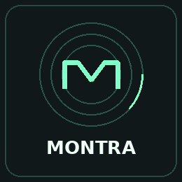
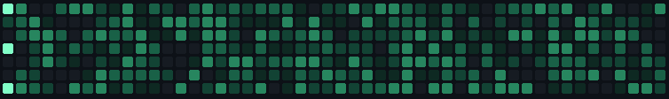

<h1 align="center">✦ MONTRA MARKETS ✦</h1>

  

<strong>The house of all launches on Elysium.</strong>

  
  
  

## About Montra

- 🚀 Launch tokens and open a market in the same transaction.
- 🔄 Discover and trade Elysium tokens through Uniswap v4 pools.
- 🔍 Verify contract addresses and the official $MONTRA token on-chain.

## Build on Montra

| Resource | What you'll find |
| --- | --- |
| [Build Guide](https://montramarkets.xyz/docs/build) | Discover pools, quote swaps, and integrate token launches. |
| [Contract Address Book](https://montramarkets.xyz/docs/contracts) | Find Elysium deployments and resolve addresses through the on-chain registry. |
| [Contract Reference](https://montramarkets.xyz/docs/reference) | Look up contract methods, events, and data structures. |
| [Public API](https://montramarkets.xyz/docs/api) | Find endpoints for token and market data. |
| [$MONTRA](https://montramarkets.xyz/docs/montra) | Learn about the platform token and how to verify its official contract. |
